<div align="center">

<picture>
  <source media="(prefers-color-scheme: dark)" srcset="./dark.svg">
  <source media="(prefers-color-scheme: light)" srcset="./light.svg">
  
</picture>

</div>

---

### `SYSTEM.INITIALIZE` &nbsp;|&nbsp; `DEVELOPER ENVIRONMENT`

```bash
developer@terminal:~$ ./handshake.sh --mode=production --verbose
[OK] Kernel v6.12.0 initialized · TLS 1.3 encrypted · 12ms latency
[OK] Profile modules loaded: Full-Stack Systems · Cloud Architecture · Open Source
[OK] Status: Active Node · Ready for high-impact engineering collaboration
```

---

## ⚡ Executive Summary

**Senior Software Engineer & Systems Architect** specializing in resilient, high-throughput distributed architectures, modern full-stack web applications, and developer platform infrastructure. 

- 🔭 **Active Focus**: Building fault-tolerant event pipelines, scalable microservices, and high-performance user interfaces.
- 📐 **Architecture Principles**: Clean code, modular domain separation, automated zero-downtime CI/CD, and strict security posture.
- 🌐 **Collaboration Model**: Remote-first, asynchronous-friendly, and open-source contributor.

---

## 🛠️ Technology Stack & Toolchain

### Core Languages & Systems


### Web & API Frameworks


### Cloud, Storage & Orchestration


---

## 🏗️ Selected Production Systems & Architectural Proofs

```text
┌─────────────────────────────────────────────────────────────────────────────┐
│ 01. RUNTIME INFRASTRUCTURE PLATFORM                                         │
│ High-throughput distributed services, event stream processor & API gateway  │
├─────────────────────────────────────────────────────────────────────────────┤
│ • Architecture : Distributed microservices with event-driven message bus    │
│ • Stack        : Go, Apache Kafka, Redis cluster, gRPC, Docker, Kubernetes  │
│ • Key Metrics  : Sub-15ms p99 latency, zero-loss durability, automatic failover │
└─────────────────────────────────────────────────────────────────────────────┘

┌─────────────────────────────────────────────────────────────────────────────┐
│ 02. FULL-STACK DEVELOPER PLATFORM & TELEMETRY                               │
│ Extensible CLI tooling, automated CI/CD runners, and developer dashboard    │
├─────────────────────────────────────────────────────────────────────────────┤
│ • Architecture : Modular monorepo with strict contract enforcement          │
│ • Stack        : TypeScript, Next.js, Rust core CLI, PostgreSQL, Docker     │
│ • Highlights   : Real-time telemetry, automated release pipelines, secure RBAC│
└─────────────────────────────────────────────────────────────────────────────┘
```

---

## 📊 Engineering Standards & Quality Manifesto

- **Idempotency & Resilience**: Distributed systems designed to handle node degradation, transient network partitions, and message retries gracefully.
- **Type Safety Everywhere**: End-to-end type safety from database schemas and protocol buffers up to client state management.
- **Continuous Observability**: Structured JSON logging, distributed tracing (OpenTelemetry), and actionable metrics.
- **Automated Verification**: Comprehensive unit, integration, and end-to-end testing gating every merge commit.

---

## 🌐 Connect & Network Endpoints

```text
┌───────────────────┬─────────────────────────────────────────────────────────┐
│ Endpoint          │ Target Location                                         │
├───────────────────┼─────────────────────────────────────────────────────────┤
│ 🐙 GitHub         │ https://github.com                                      │
│ 💼 LinkedIn       │ https://linkedin.com                                    │
│ 🌐 Portfolio      │ https://developer.portfolio                             │
│ ✉️ Direct Inquiries│ developer@domain.com                                    │
│ 🔑 GPG Key ID     │ 0x88F2C49B (available via keyservers)                   │
└───────────────────┴─────────────────────────────────────────────────────────┘
```

---

## 🎨 System Customization Guide

This GitHub Profile README system is intentionally modular and configurable. To adapt this setup for your personal identity:

1. **Profile Metadata**: Open `dark.svg` and `light.svg` in any code editor to update the name, title, status labels, and endpoints.
2. **ASCII Portrait**: The ASCII portrait in `dark.svg` and `light.svg` is rendered with SVG `<text>` and `<tspan>` tags. You can replace the lines of characters with your own customized ASCII art or photo conversion using standard monospace characters (`.·:+*#%@`).
3. **Role Rotation**: Adjust the `<text>` and `<animate>` blocks in Section 1 to customize your titles and cycle timings.
4. **Theme Customization**: Colors are defined in the SVG `<defs>` section (linear gradients and CSS custom styles) for easy adjustment.

---

<div align="center">
  <sub>Built with native SVG, SMIL animations, and GitHub Markdown. Self-contained &amp; dependency-free.</sub>
</div>
